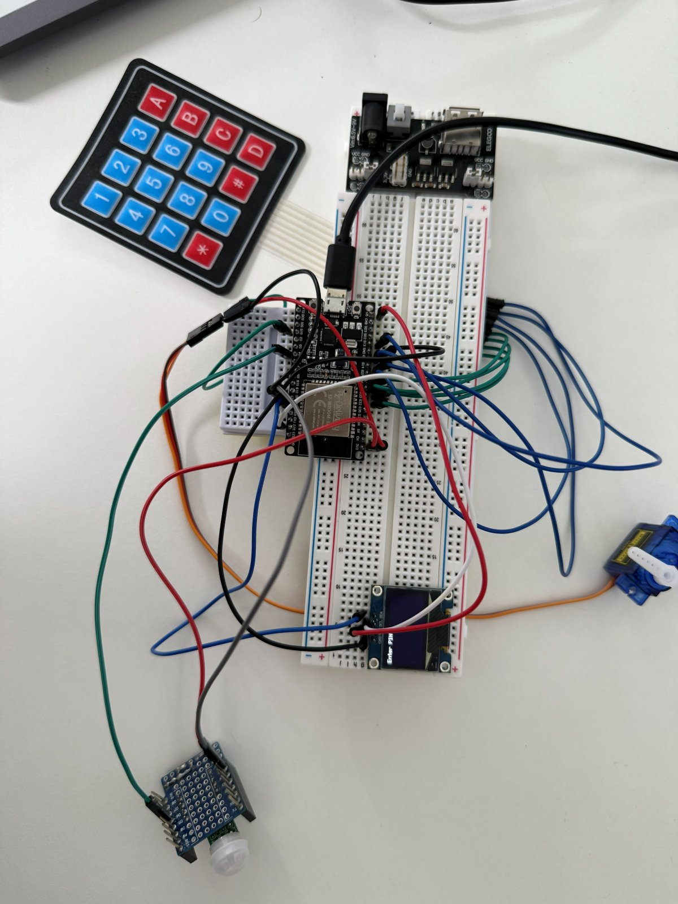
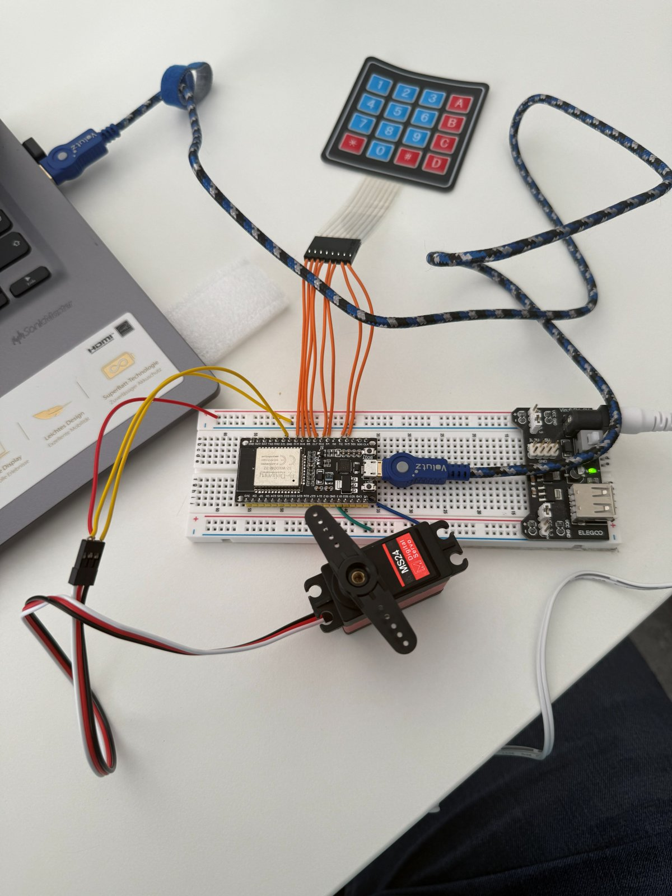
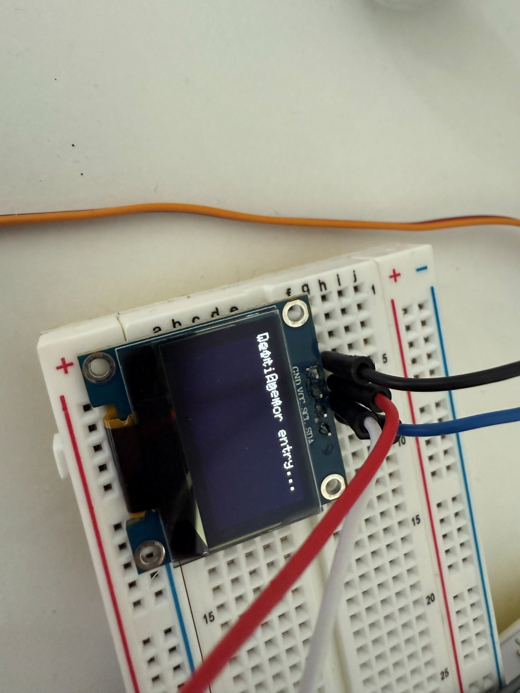

# Smart Door Lock – ESP32, MQTT

Elective project (PC-Interface technology), FH CAMPUS 02, Graz. A PIN-controlled door lock on an ESP32 with remote control and event logging over MQTT.

> **Note:** the original sketch was lost. This code is a **reconstruction** from my project presentation (includes, MQTT topics, lock/unlock logic, logger and callback are as presented; the keypad loop, web page and pin numbers are re-implemented). I will mark it as tested once I have run it on the hardware again.

## Hardware

## Features
- PIN entry on a 4x4 keypad (`#` = enter, `*` = clear), feedback on an I2C OLED (SSD1306)
- Servo moves the lock (90° locked, 0° open); auto-lock after 10 s
- PIR sensor: motion events are logged
- MQTT broker `mqtt.croku.at`: status (`/lock/status`), event log (`/lock/logs`), commands `lock` / `unlock` (`/lock/command`)
- Local web page on the ESP32 access point (192.168.4.1): status, lock/unlock, change PIN

## Hardware and pins (adjust in the sketch)
| Part | ESP32 pin |
|---|---|
| Servo signal | GPIO 18 |
| PIR output | GPIO 19 |
| OLED SDA / SCL | GPIO 21 / 22 |
| Keypad rows | 13, 12, 14, 27 |
| Keypad columns | 26, 25, 33, 32 |

## Setup
1. Install in the Arduino IDE: ESP32 board package, `PubSubClient`, `ESP32Servo`, `Keypad`, `Adafruit GFX`, `Adafruit SSD1306`.
2. Copy `secrets.example.h` to `secrets.h` and fill in Wi-Fi and PIN.
3. Upload and test: `mosquitto_pub -h mqtt.croku.at -t /lock/command -m unlock`.

## Known limitations (and what I would change)
- MQTT runs unencrypted on port 1883 without a login. On a public broker anyone who knows the topic can send `unlock`. The topics are public-broker defaults from the project; use a unique topic prefix. Next step: TLS on port 8883 plus broker username/password.
- The PIN is kept in plain text in RAM and there is no lock-out after wrong attempts.
- Planned: app dashboard, cloud log storage, RFID/NFC.
